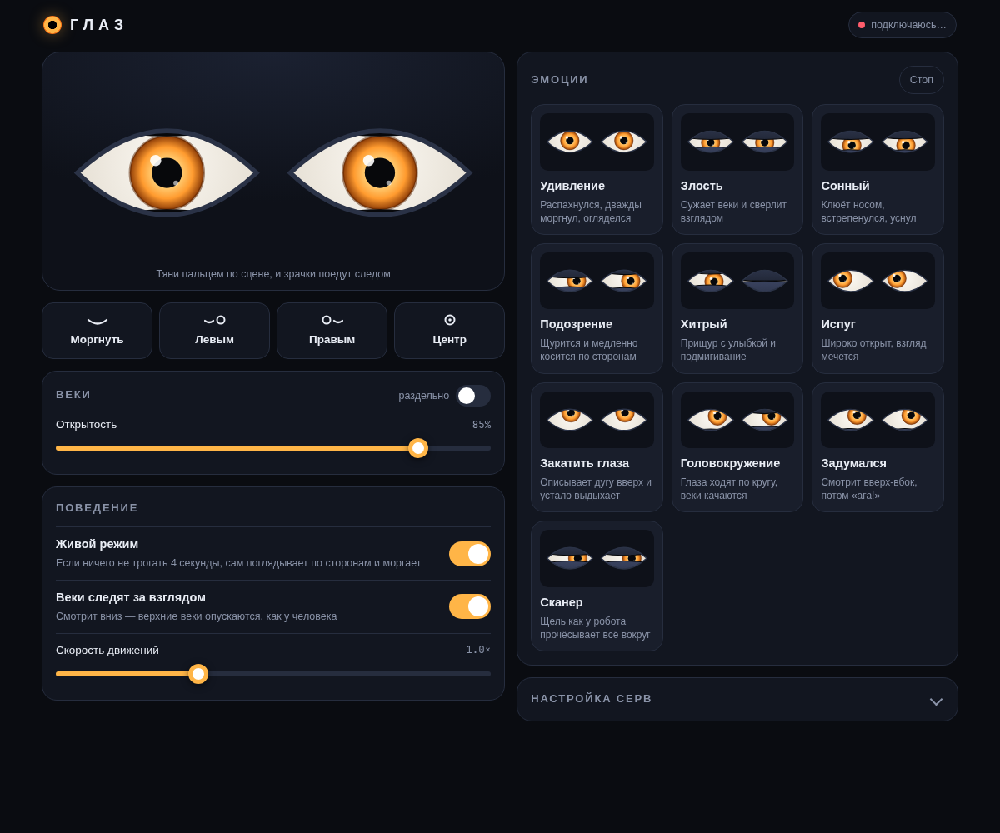
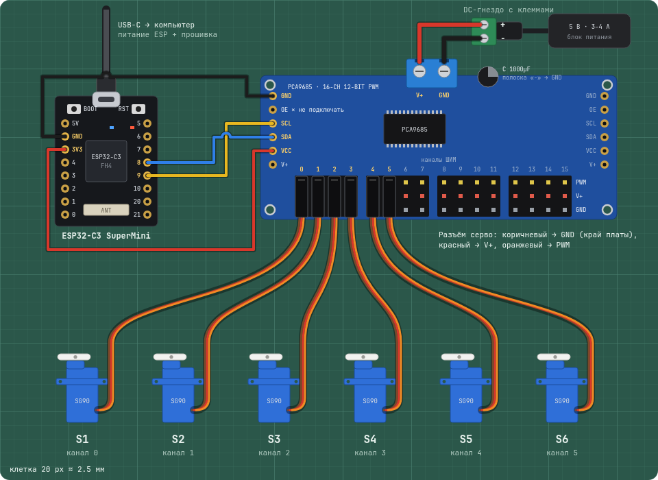

# Аниматронный глаз на 6 сервах

Пара глаз на шести сервоприводах. Управляются с телефона: ESP32-C3 раздаёт свою Wi-Fi сеть и страницу пульта. На пульте можно водить зрачками пальцем, управлять каждым веком и запускать 10 готовых эмоций.



## Что умеет

- **Взгляд.** Тянешь пальцем по сцене, и зрачки едут следом. Рисунок на странице повторяет реальное положение серв.
- **Веки.** Один ползунок открывает и закрывает все веки сразу. В режиме «раздельно» каждое из четырёх век управляется своим ползунком. Есть кнопки «моргнуть», «подмигнуть левым» и «подмигнуть правым».
- **10 эмоций,** в каждой работают все шесть серв: удивление, злость, сонный, подозрение, хитрый, испуг, закатить глаза, головокружение, задумался, сканер.
- **Живой режим.** Если пульт не трогать 4 секунды, глаз сам поглядывает по сторонам и моргает через случайные промежутки.
- **Веки следят за взглядом.** Когда глаз смотрит вниз, верхние веки опускаются, когда вверх, поднимаются, как у человека.
- **Настройка серв со страницы.** Роль каждой сервы, пределы хода в мкс с кнопкой «тест», переворот направления. Всё сохраняется в память платы.

## Железо

| Компонент | Кол-во | Примечание |
|---|---|---|
| ESP32-C3 SuperMini | 1 | контроллер, Wi-Fi |
| PCA9685 (16 каналов, I²C) | 1 | драйвер серв |
| SG90 / MG90S | 6 | сервоприводы |
| Понижающий преобразователь 5 В | 1–2 | питание серв (и ESP без USB) |
| Конденсатор 470–1000 мкФ, от 10 В | 1 | на клеммник питания серв |

## Подключение



| Откуда | Куда | Зачем |
|---|---|---|
| ESP `GPIO8` | PCA `SDA` | I²C данные |
| ESP `GPIO9` | PCA `SCL` | I²C тактирование |
| ESP `3V3` | PCA `VCC` | питание логики PCA, строго 3.3 В |
| ESP `GND` | PCA `GND` | общая земля |
| +5 В питания серв | клеммник PCA `V+` | питание серв |
| − питания серв | клеммник PCA `GND` | |
| Сервы S1–S6 | каналы PCA 0–5 | коричневый провод к краю платы |

`OE` на PCA не подключается.

### Роли серв

| Серва | Канал | Что двигает | Калибровка, мкс |
|---|---|---|---|
| S1 | 0 | правое нижнее веко | 400 … 1050 |
| S2 | 1 | правое верхнее веко | 1800 … 550 |
| S3 | 2 | зрачки вверх-вниз | 1600 … 2150 |
| S4 | 3 | левое верхнее веко | 1500 … 2520 |
| S5 | 4 | левое нижнее веко | 1400 … 2100 |
| S6 | 5 | зрачки влево-вправо | 1150 … 1950 |

Это значения по умолчанию в прошивке. Если сервы стоят иначе, роли и пределы меняются на странице в разделе «Настройка серв», а потом сохраняются кнопкой «Сохранить в плату».

### Питание

- **Сервы питай от отдельного источника 5 В** на 3 А и больше (для MG90S от 4 А). Подключай его в клеммник PCA. Боковой пин `V+` тоже соединён с этой линией, но через него проходит меньше тока, и на нём нет защиты от переполюсовки.
- **ESP можно питать двумя способами:**
  - от USB;
  - от понижайки 5 В на пин `5V`. Перед подключением выставь на ней 5.0–5.1 В мультиметром.
- **Не подключай USB и понижайку на `5V` одновременно,** если между ними на плате нет диода. Это легко проверить: подключи только USB и измерь напряжение на пине `5V`. Около 5.0 В значит, что диода нет. Если нужны оба источника сразу, поставь диод Шоттки (SS14, 1N5819) от понижайки к `5V`.
- **Минусы всех источников должны быть соединены.**

## Прошивка

Нужен [PlatformIO](https://platformio.org/).

```bash
pio run -t upload       # собрать и залить
pio device monitor      # лог (115200)
```

Если плата не прошивается, зажми **BOOT**, нажми **RST** и отпусти **BOOT**.

### Подключение к пульту

1. Подключи телефон к Wi-Fi **`Glaz`**, пароль **`glaz2026`**.
2. Страница откроется сама, как окно входа в сеть. Если не открылась, набери в браузере **http://192.168.4.1**.

Имя сети и пароль задаются в начале `src/main.cpp` (`AP_SSID`, `AP_PASS`).

## Калибровка серв

В папке `calibration/` лежит отдельная прошивка. С её помощью находят начало и конец рабочего хода каждой сервы.

```bash
cd calibration
pio run -t upload && pio device monitor
```

| Клавиша | Действие |
|---|---|
| `1`..`6` | выбрать серву |
| `z` / `c` | −50 / +50 мкс |
| `a` / `d` | −10 / +10 мкс |
| `A` / `D` | −1 / +1 мкс |
| `[` / `]` | запомнить начало / конец хода |
| `g` | плавный прогон по найденному ходу |
| `o` / `O` | отпустить серву / все |
| `i` | скан шины I²C |
| `p` | таблица и готовые массивы для кода |

Веди серву до упора механизма, отведи от него на 20–30 мкс и запомни это значение. Готовые числа из `p` перенеси в `DEF` в `src/main.cpp` или введи на странице пульта.

## Устройство проекта

```
├── src/
│   ├── main.cpp       Wi-Fi точка, веб-сервер, WebSocket, движок движений
│   ├── emotions.h     эмоции: кадры движений
│   └── page.h         генерируется из web/index.html при сборке
├── web/index.html     страница пульта (одним файлом, без интернета)
├── tools/embed_page.py  встраивает страницу в прошивку перед сборкой
├── calibration/       прошивка для поиска пределов серв
└── docs/              схема и скриншоты
```

### Как устроено движение

Поза описывается шестью числами: `x`, `y` от −1 до 1 (вверх = +) и четыре века от 0 (закрыто) до 1 (открыто). Каждые 10 мс движок плавно подтягивает текущую позу к целевой (экспоненциальное сглаживание, скорость задаётся на странице). Затем поверх накладываются моргания и наклон век за взглядом. После этого каждая роль пересчитывается в микросекунды своей сервы по её пределам: `us = min + t × (max − min)`.

### Свои эмоции

Эмоция в `src/emotions.h` — это список кадров:

```c
{мс ожидания, x, y, верх Л, низ Л, верх П, низ П, медленность, действие}
```

- `x`, `y`: от −100 до 100; веки: от 0 до 100; `K` значит «не менять».
- Медленность в десятых: 10 — обычная скорость, 40 — в 4 раза медленнее.
- Действие: 1 — моргнуть, 2 — подмигнуть левым, 3 — правым, 4 — двойное моргание.

Новую эмоцию допиши в конец массива `EMOS[]`, а её название и описание добавь в массив `EMOS` в `web/index.html`. Порядок в обоих местах должен совпадать.

### Протокол WebSocket (порт 81)

Страница и плата обмениваются JSON-сообщениями. Через эти же сообщения глазом можно управлять из своей программы.

| Сообщение | Действие |
|---|---|
| `{"g":[x,y]}` | взгляд, −1..1 |
| `{"l":[ул,лл,уп,лп]}` | веки, 0..1 |
| `{"b":0}` / `1` / `2` | моргнуть / левым / правым |
| `{"e":i}` | запустить эмоцию, `-1` — стоп |
| `{"c":1}` | в центр |
| `{"lv":1}`, `{"fo":1}`, `{"sp":1.5}` | живой режим, веки за взглядом, скорость |
| `{"cal":{"i":0,"mn":400,"mx":1050,"r":5}}` | пределы и роль сервы |
| `{"t":{"i":0,"us":1500}}` | поставить серву в положение на 2.5 с |
| `{"save":1}`, `{"def":1}` | сохранить / вернуть заводскую калибровку |

Плата в ответ присылает `{"s":[...],"e":эмоция,"lv":0|1}` (поза ×100, до 20 раз в секунду) и `{"cfg":{...}}` при подключении и после изменений.

## Если что-то не так

- **Сеть `Glaz` не видна или отваливается.** У ESP32-C3 SuperMini слабая разводка антенны. Поэтому в прошивке мощность передатчика уже снижена до 8.5 дБм, на полной мощности сеть работает нестабильно.
- **Сервы дёргаются.** Обычно не хватает тока или земли не соединены. Поставь конденсатор на клеммник и источник помощнее.
- **«Порт занят» при прошивке.** Закрой `pio device monitor`.
- **Плата после прошивки пишет `boot:0x5 … waiting for download`.** Так бывает, если открыть USB-порт C3 программой, которая сама переключает линии DTR/RTS. Нажми RST или переподключи USB.
- **Страница пишет «PCA9685 не отвечает».** Проверь SDA, SCL, VCC и GND между ESP и PCA.
